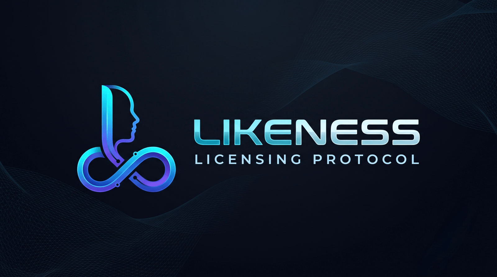
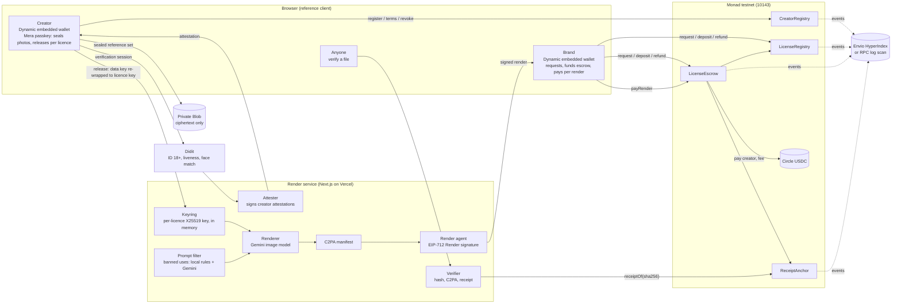

<p align="center"></p>

# Likeness

**License your face to AI. Your terms, paid per image.**

> 🏆 **Winner, Monad Blitz Pune V3** (10 October 2026)

**Live demo:** [likeness.site](https://likeness.site) (Monad testnet) ·
**Code:** [github.com/rohitshukla11/Likeness](https://github.com/rohitshukla11/Likeness) ·
**Demo video:** <DEMO_URL> · **Pitch video:** <PITCH_URL>

Likeness is a likeness-licensing protocol on Monad, with a reference app on top, running on Monad
testnet. Real, verified adults license their face to brands and AI tools, get paid in USDC for every image
made with it, and can pull it back at any time.

## The problem

Generative AI can put anyone's face into an ad in seconds. The people in those images are rarely asked,
almost never paid, and have no way to stop it. Brands that *want* to use a real person's likeness have
no clean way to get consent, pay per use and prove it later: today the options are a one-off model
release signed for a photoshoot, or nothing at all.

## The solution

Likeness turns consent into a licence that software can check. A creator proves they are a real, live
adult, seals encrypted reference photos of their face and publishes terms. A brand requests a licence,
the creator approves it, and every image rendered under it pays the creator and records an on-chain
receipt in the same transaction. Each file carries a C2PA content credential, anyone can check it, and
one click revokes the licence so the next render is refused.

## How it works

**Verify → License → Earn → Prove or revoke**

1. **Verify.** The creator signs in with email, and a Dynamic embedded wallet is created for them (with a
   one-time MON top-up for gas). Didit checks an ID document for 18+, a liveness selfie and a
   selfie-to-ID face match. Three guided photos are matched to that selfie, encrypted in the browser under
   a key from the creator's passkey (Mera), and only the ciphertext is uploaded. The platform attests the
   creator on chain.
2. **License.** The creator sets uses, regions, a price per render and limits. A brand with a brand
   profile requests a licence; the creator approves it with an EIP-712 signature (or it is issued at once
   inside their auto-approve terms). The brand deposits USDC into escrow.
3. **Earn.** The creator releases their photos to that licence only. Each render checks the licence, the
   cap, the escrow and the banned-use filter, decrypts the photos in memory, renders with Gemini, signs a
   C2PA manifest and calls `LicenseEscrow.payRender`: the creator is paid, the 10% fee is taken and the
   receipt is anchored, in one transaction.
4. **Prove or revoke.** Anyone can drop a file on `/verify` and see Licensed, Expired, Revoked or
   Unknown, with the creator, the licensee and the receipt. The creator can revoke one licence or all of
   them: the next render is refused, earlier files verify as "licensed when made, since revoked", and the
   brand refunds the unused escrow.

## Track 04: Trust, Identity & AI Infrastructure

Likeness is infrastructure, not just an app: a likeness-licensing protocol any AI image or ad tool can
plug into. It provides three things such tools can't build alone:

- **Verified identity:** every creator is a Didit-verified, live adult, attested on chain, with the
  verification level recorded and shown.
- **Consent:** a licence exists only with the person's signature (or inside terms they published), is
  scoped to a use, regions, a render cap and a period, and can be revoked in one click.
- **Provenance:** every image carries a C2PA credential and an on-chain receipt keyed by its hash, and
  anyone can verify a file. The four contracts and the verifier are open: the app here is one client.

## Why Monad

Pay-per-render means **one transaction per generated image**: the creator is paid and the receipt is
recorded together, before the file reaches the brand. Per-image payment only works when the fee is well
below the image's value and confirmation lands before delivery.

- **Confirmation, measured on Monad testnet** (send to receipt over the public RPC):
  `CreatorRegistry.register` in **853 ms** (2026-10-06, `pnpm seed`); plain MON transfers in 945 ms and
  1,450 ms. Monad documents 300 ms block frequency and 600 ms finality
  ([docs](https://docs.monad.xyz/introduction/monad-for-users.md)), so the receipt is final before the
  file is delivered, and a revocation binds the next render.
- **Gas, measured:** `payRender` used **368,502 gas** for a licence's first render and **300,502 gas** for
  later ones (`pnpm demo --fork`: the deployed bytecode and state on an anvil fork of Monad testnet, with
  Circle's USDC contract). Monad charges the gas limit, not gas used
  ([gas pricing](https://docs.monad.xyz/developer-essentials/gas-pricing.md)), so the service sends the
  estimate plus 15%: about **0.043 MON** for a first render and **0.035 MON** after, at the 102 gwei
  testnet gas price measured on 2026-10-06.

## Traction

The Blitz entry was an early prototype. Since then we've built Likeness into a full product, live on
Monad testnet: verified onboarding, passkey encryption, licences with USDC escrow,
real AI renders with content credentials, a public verifier, revocation and refunds, plus creator and
brand profiles with sample renders.

We've also spoken with creators and brands directly. Creators described the hustle of shoots (travel,
long days, reshoots) for a one-time fee; brands described delayed content, slipping shoot dates and the
effort of recreating an ad for every new variation.

## Contracts on Monad testnet

Deployed and verified on Monad testnet. Mainnet launch follows an independent audit and production-grade
identity verification.

Deployed 2026-10-10 (UTC) from `0x68343Aa0598b7FCAA102769D172e59cdDfae10f2`, starting at block
69,802,475. All four contracts are verified as **exact matches** on MonadVision's Sourcify. Machine-readable:
[`deployments/monad-testnet.json`](deployments/monad-testnet.json).

| Contract | Address | Deploy tx |
|---|---|---|
| CreatorRegistry | [`0xc0eadb706D175e317c8D89cD250781fC3d14008B`](https://testnet.monadvision.com/address/0xc0eadb706D175e317c8D89cD250781fC3d14008B) | [`0x8cac5aca…`](https://testnet.monadvision.com/tx/0x8cac5aca0d857b6f7a27ec09192c8b3888b26c0e1136abc0e20d87af41f9488e) |
| LicenseRegistry | [`0x38c8EcA2782fB64C23daB9B3432E668F81Fbacc9`](https://testnet.monadvision.com/address/0x38c8EcA2782fB64C23daB9B3432E668F81Fbacc9) | [`0x73fde51c…`](https://testnet.monadvision.com/tx/0x73fde51caa9f39d94f749786b330a183b217021739396cb2692d4cadb1c39eaf) |
| ReceiptAnchor | [`0x272b5Bdf04564dA897a66aE84E18c822876d72Fe`](https://testnet.monadvision.com/address/0x272b5Bdf04564dA897a66aE84E18c822876d72Fe) | [`0x9ca3face…`](https://testnet.monadvision.com/tx/0x9ca3facefbf70cd26b05ac89c922cea3df9ba0b926ff1790fcfbf25aff49ff32) |
| LicenseEscrow | [`0xf7659B8CFA2A484aE30e638c2490131Bc568dA0A`](https://testnet.monadvision.com/address/0xf7659B8CFA2A484aE30e638c2490131Bc568dA0A) | [`0xa11e3ba0…`](https://testnet.monadvision.com/tx/0xa11e3ba01d4ad329e81cee56093311ca0006af390f089a52e9611042ea585439) |
| USDC (Circle) | [`0x534b2f3A21130d7a60830c2Df862319e593943A3`](https://testnet.monadvision.com/address/0x534b2f3A21130d7a60830c2Df862319e593943A3) | [Circle docs](https://developers.circle.com/stablecoins/usdc-contract-addresses) |

Wiring: [`LicenseRegistry.setEscrow`](https://testnet.monadvision.com/tx/0x8ae5bf067e480cb27d35919210aa720bca2c048b05868b57e837c0e6751412bb),
[`ReceiptAnchor.setEscrow`](https://testnet.monadvision.com/tx/0x8748e8933ef3b643b1a9ba7609824c9494afb590b5f9f88dfdf548a8e2910550),
[`LicenseEscrow.setRenderAgent`](https://testnet.monadvision.com/tx/0x51c02ed8adf3587c2af3cdb07cc62470d13f1aed9c2604351521dd4f06bca2a7).
Roles: attester `0x8d53e13407890e18022bfAa413193ba4C6DCc1a5`; render agent
`0x87CA75118FD0C7EF3090c82E8df4CF4b56cD03cA`; owner and treasury, the deployer; fee 10%.

| Contract | What it holds | Who writes |
|---|---|---|
| [`CreatorRegistry`](contracts/src/CreatorRegistry.sol) | Platform-signed attestation (Didit: ID 18+, liveness, face match), terms, payout, revocation epoch | Creator (terms, payout, revoke-all); the attester signs but cannot submit; the owner rotates the attester and can suspend for abuse |
| [`LicenseRegistry`](contracts/src/LicenseRegistry.sol) | Non-transferable, expiring licences (ERC-721 locked per [ERC-5192](https://eips.ethereum.org/EIPS/eip-5192)) | Brand requests with the creator's EIP-712 approval, or inside auto-approve terms; creator revokes; only the escrow counts renders |
| [`LicenseEscrow`](contracts/src/LicenseEscrow.sol) | USDC per licence; pays the creator per render, refunds the rest | Brand deposits; a render needs the brand's wallet **and** a render agent's signature |
| [`ReceiptAnchor`](contracts/src/ReceiptAnchor.sol) | One receipt per rendered file, looked up by its sha256 | Only the escrow, only inside a paid render |

## Sponsor integrations

- **Dynamic** ([write-up](docs/dynamic.md)): email sign-in and an embedded wallet for every creator and
  brand, live on likeness.site. Built behind interfaces and switched on by credentials: the render
  agent as a Dynamic server wallet (`pnpm agent:dynamic`; a local agent key signs until `DYNAMIC_API_KEY`
  is set), and **delegated access** so a brand's wallet sends exactly one transaction type,
  `payRender`, through the render service under a policy and a total cap. Delegated access is
  sandbox-only without a Dynamic Enterprise plan and is not enabled on the live site.
- **Mera** ([write-up](docs/mera.md)): passkey PRF output as encryption key material, never as a wallet.
  The creator's photos are encrypted under the `likeness:reference` namespace; approving a licence
  re-wraps the data key under a per-licence namespace; a per-brand namespace derives an unlinkable
  identity. A synced second device re-derives the same keys: the cross-device test is automated in
  [`crypto.test.ts`](web/lib/crypto/crypto.test.ts).
- **Envio:** [`indexer/`](indexer) is an Envio HyperIndex for all four contracts (HyperSync with an
  `ENVIO_API_TOKEN`, RPC otherwise). It is not hosted for the live site: there, history comes from the
  contracts' logs over RPC, cached between requests; current state always comes from the contracts.

## Architecture



## Business model and go-to-market

- **Revenue:** a 10% fee on every paid render, taken by the escrow contract in the same transaction that
  pays the creator. Then a verification and licensing API for AI tools: check a face's licence, pay per
  render and anchor receipts through the same contracts.
- **Customers:** AI ad and avatar tools that need real, consented faces, and the brands that use them.
- **Go-to-market:** start with AI UGC ad tools and the creators who already make UGC ads.

## Roadmap

- **Next: video ad renders:** full short ads from a licensed face, under the same licence, receipt and
  verifier.
- **Then: voice licensing:** creators license their voice on the same terms, with the same consent,
  payment and revocation.
- **One person, one creator:** today one person could register more than one wallet, because nothing
  compares identities across wallets. The fix is a keyed duplicate-document check: an HMAC, under a
  server secret, of the ID document's country, type and number from Didit's decision, refusing a second
  attestation with the same value without storing the number itself.
- **Casting calls:** a brand posts a brief, and matching creators choose whether to reveal themselves.
- **Path to mainnet.** Today Likeness runs on Monad testnet. Before it moves to Monad mainnet:
  - an independent audit of the four contracts, especially the escrow and the payout logic;
  - Didit at the full verification level (active liveness), under a production agreement and a
    data-processing agreement;
  - a C2PA signing certificate from a trusted certificate authority, replacing the test certificate;
  - Dynamic's production environment instead of the sandbox;
  - sponsored gas instead of a gas top-up;
  - a legal entity, and licence terms reviewed by counsel for likeness licensing.

## Privacy and safety

- **Only ciphertext is stored.** Reference photos are encrypted in the creator's browser (AES-256-GCM)
  under a key derived from their passkey through Mera. The server stores ciphertext and hashes, and the
  chain holds only a hash of the encrypted manifest and of the Didit session ID. Keys and plaintext live
  in memory for one operation and are zeroed afterwards.
- **What Didit sees, and for how long.** Didit sees the ID document and the liveness selfie, and at the
  `full` level matches the three reference photos. Likeness calls those photo matches with
  `save_api_request=false`, and deletes the session with `privacy_erasure` as soon as the attestation is
  signed. Whether Didit also keeps a face-search embedding for duplicate detection depends on the
  workflow's settings in the Didit console; the code doesn't set it. Didit's own retention is a console
  setting (unlimited by default), and it uses data for model training unless the organisation opts out;
  the operator must set both. Likeness keeps the outcome and the session ID, never the date of birth,
  document images or selfie.
- **What Google sees, and for how long.** The Gemini image model receives the decrypted reference photos
  for each render. On a billed key Google doesn't use them to improve its products, but logs them for 55
  days for abuse monitoring ([Gemini API terms](https://ai.google.dev/gemini-api/terms)). A free-tier key
  must never be used with creators' photos.
- **Banned uses are enforced in the contract.** Political, adult, anything involving minors,
  impersonation and deception are a constant bitmask in [`Categories.sol`](contracts/src/Categories.sol):
  no terms, signed deal or role can license them. The render service applies the same list to every
  prompt before generation.
- **Adults only.** `CreatorRegistry` registers only attested adults (18+ computed from the ID's date of
  birth), and the app is presented as adults-only.
- **Every output is marked:** a C2PA manifest declaring it AI-generated, Google's SynthID watermark, and
  an on-chain receipt keyed by its exact bytes.

## Known limitations

- **Didit level.** The live site runs `VERIFICATION_LEVEL=free`: passive liveness, with the reference
  photos matched on our server. It resists deepfakes and camera injection less well than `full` (active
  liveness and Didit's 1:1 match), which needs Didit credit. The level is recorded on chain and shown.
- **Test C2PA certificate.** Manifests are signed with a locally generated certificate that is not on the
  C2PA trust list; the verifier says so.
- **Dynamic delegated access is sandbox-only**, so brands confirm each `payRender` in their own wallet.
- **Face detector licence.** The free-level matcher uses the YuNet detector, whose weights are MIT but
  were trained on WIDER FACE (CC BY-NC-ND images). The production replacement is Google's MediaPipe
  BlazeFace (Apache-2.0), which needs converting to ONNX; it is not swapped yet.
- **No TEE.** Render keys and decrypted photos are held in ordinary process memory on one instance.
- **Receipts bind exact bytes.** A re-encoded or cropped copy verifies as Unknown. Revocation is not
  recall: files delivered earlier still exist and verify as "licensed when made, since revoked".
- **Test data on chain** (Monad testnet, from the team's own runs): the creators
  `0xc8b944909e67b62e7be7313534b6ae2646622d9a` and `0x3fb869f8d47fb9f6145f716a0918484b0dbc6375`; licence
  #1, between the first of them and the DEV test brand `0x41083f240e968c4a37a39404d40f1c68210e5b9f`,
  with two paid renders and 12.00 USDC left in escrow; and an earlier unverified test creator on
  previous contracts, suspended on 2026-10-10.

## Running it locally

Needs Node 22 or later and Foundry 1.8.3 (for anvil and the contracts).

```sh
cd web
cp .env.example .env.local     # local defaults; add credentials as they arrive
pnpm install
pnpm c2pa:testcert             # once: a TEST C2PA signing chain in ../.secrets/c2pa
pnpm dev                       # http://localhost:3000
```

Each credential switches on one feature, and `/status` shows what is configured: Dynamic
(`NEXT_PUBLIC_DYNAMIC_ENV_ID`), Didit (`DIDIT_API_KEY`, `VERIFICATION_LEVEL`, workflow IDs; the `free`
level also needs `pnpm face:models`), Gemini (`GEMINI_API_KEY`, a billed key) and the MON gas top-up
(`DRIP_KEY_FILE`).

**The whole protocol in one command**, on a local anvil fork of Monad testnet with the deployed contracts
and Circle's real USDC contract (a throwaway, unverified test creator exists only there):

```sh
pnpm demo --fork
```

It registers the test creator, funds a test brand, issues and funds a licence, releases the key, runs two
renders and verifies one, revokes, shows the next render refused, and refunds, printing every
transaction.

**DEV wallets.** With `DEV_WALLETS=1` in `.env.local`, the header picker can act as the seeded test
brand, marked DEV. Production builds never offer them.

### Tests

```sh
cd contracts && forge test     # unit, fuzz, invariant; with MONAD_RPC_URL set, also the Monad testnet fork suite
cd web && pnpm test            # crypto, render pipeline, profiles, and the licence lifecycle on an anvil fork
cd indexer && pnpm test        # Envio handlers on the in-memory test indexer
```

- **Contracts:** every revert path; fuzz tests that banned uses are never stored or licensed and that
  each render conserves funds; an invariant suite for USDC conservation, render caps and refunds.
- **Web:** the cross-device passkey test and envelope encryption; the banned-use filter, the C2PA round
  trip and tamper detection; and, on an anvil fork of Monad testnet with the deployed contracts and no
  mocks, the whole licence lifecycle (approval, deposit, key release, delegated and wallet `payRender`,
  verify, revoke, refund, revoke-all), re-verification at a higher level, and public profiles, samples and
  brand onboarding.

### Deploying

Production runs on Vercel at `www.likeness.site` (`likeness.site` redirects to it), with
`NEXT_PUBLIC_RP_ID=likeness.site` so passkeys work on both. Create a project from this repo with Root
Directory `web`, connect a private Blob store (`STORE_DRIVER=blob`), then from `web/` run
`sh scripts/vercel-env.sh https://www.likeness.site`: it shows the linked project's name and asks you to
type it back before writing the variables from `.env.local` and `../.secrets`. Redeploy without the build
cache and check `/status`.

## Disclosures

- **Built in the Metropolis window:** Likeness was built during the Metropolis window, including the
  prototype that won Monad Blitz Pune V3 on 10 October 2026.
- **Pre-existing code:** some design tokens (colours, type scale, radii) are reused from my earlier
  project, Whistle.
- **AI tools:** AI coding assistance from Claude Code, directed and reviewed by us; images generated with
  Gemini.
- **Dual entry:** An Arbitrum version of Likeness was submitted separately to Colosseum's Crypto World's
  Fair (rohitshukla11/likeness.website, live at likeness.website).

## Contributor notes

- **No real brand or product names** in demos, fixtures, tests, docs, screenshots or placeholder text. Use
  fictional ones, such as "Brew & Co.", and `.example` domains.

## Licence

[MIT](LICENSE)
